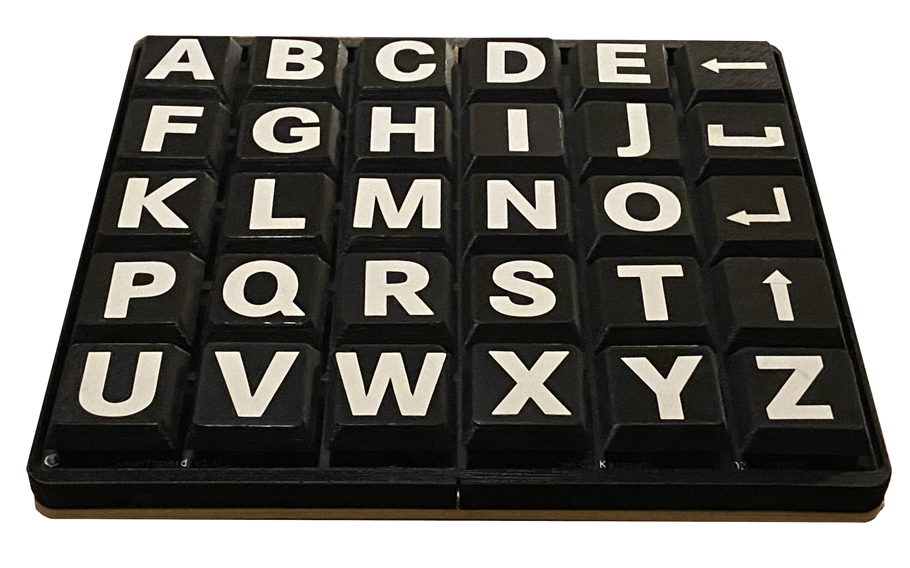

# Spellboard

_A large key cap custom keyboard, designed for spelling to communicate._

## Features

- Letter layout matching [Spellers](https://www.spellers.com/product-page/large-a-z-stencil) stencil letter board
- All 26 letters in alphabet
- Capitalize, Backspace, Enter, Space keys
- USB C connectivity
- Custom large keycaps for less reliance on fine motor skills

## Demo

https://github.com/user-attachments/assets/92936077-01a1-442b-ba66-4622e2b436ea

## BOM

- 30x 2-Pin key switches
- 30x SOD-123 diodes
- Seeed Studio XIAO RP2040
- 1x PCB
- 1x 3D Printed Enclosure Left
- 1x 3D Printed Enclosure Right
- 1x Backplate
- 8x M3x8mm screws
- 8x M3 nuts
